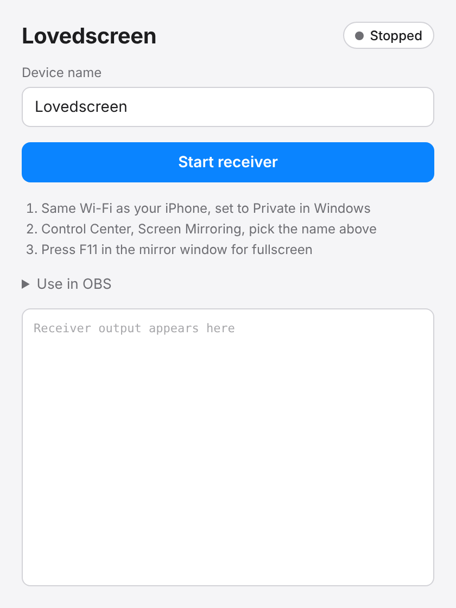
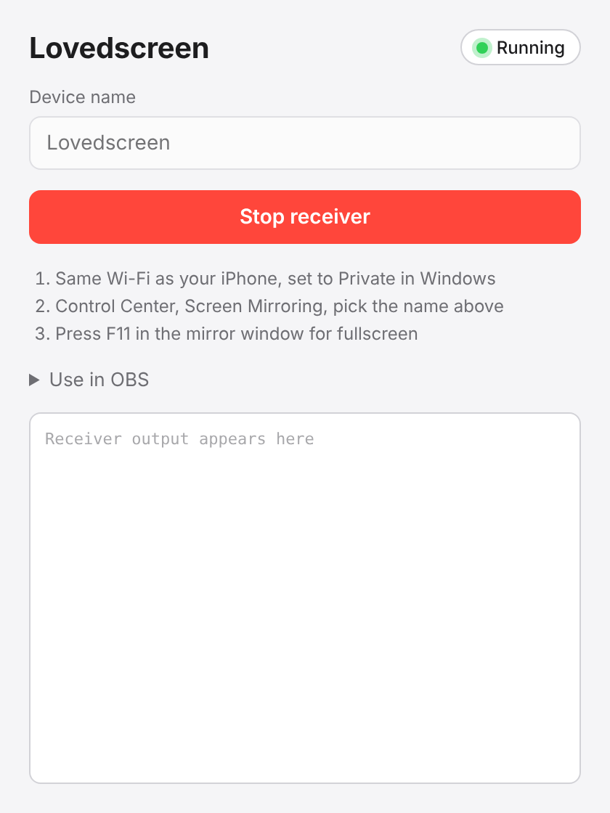
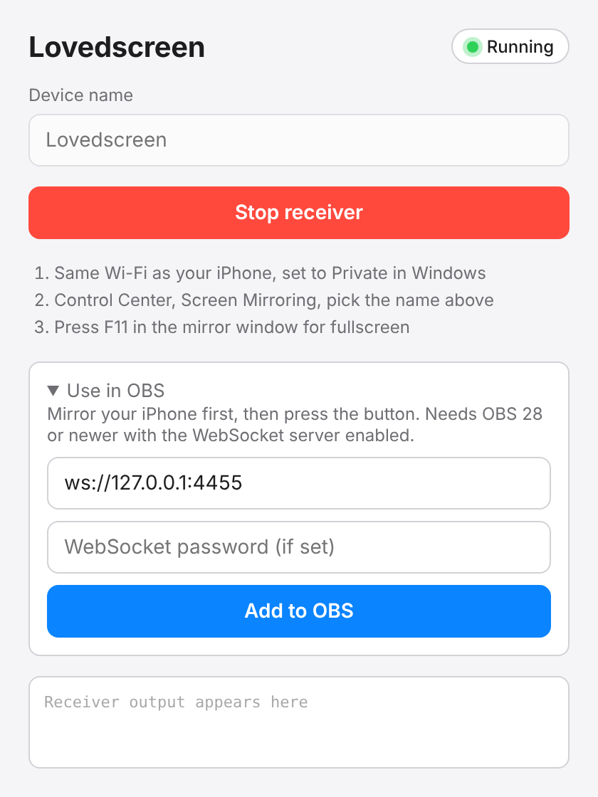

# Lovedscreen

Mirror your iPhone screen and audio to a Windows PC over Wi-Fi. A LonelyScreen-style AirPlay receiver.

- Shows up in your iPhone's Control Center, Screen Mirroring list. No app needed on the iPhone.
- Single self-contained app. The protocol layer is UxPlay's library compiled in, output goes through GStreamer.
- One-click "Add to OBS" button that creates window and audio capture sources for the mirror window.

 

## Use

1. Install and run Lovedscreen.
2. Put the PC and iPhone on the same Wi-Fi. Set the PC's network to Private.
3. Press Start receiver, then pick the device name in the iPhone's Screen Mirroring.
4. F11 toggles fullscreen in the mirror window.

For OBS, enable the WebSocket server (Tools, WebSocket Server Settings), start mirroring, then use Use in OBS, Add to OBS.

## Status

Early. Mirroring from an iPhone to Windows works in testing. Screenshots show the control panel only. Audio sync, rotation and long sessions are not well tested. Netflix and other DRM apps show black over AirPlay.

If the iPhone says "unable to connect", set your PC's network profile to Private (Windows treats some wired connections as Public and blocks the connection). Logs are in `%TEMP%\lovedscreen.log`, and the app has a Copy log button.

## Build

Windows, MSYS2 UCRT64 with Rust, Node, GStreamer, libplist and OpenSSL. See `.github/workflows/build.yml` for the exact steps.

## License

GPLv3. Includes [UxPlay](https://github.com/FDH2/UxPlay) as a submodule.
